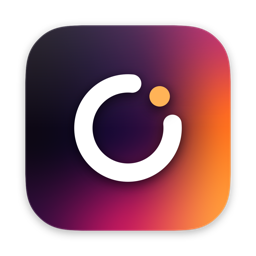
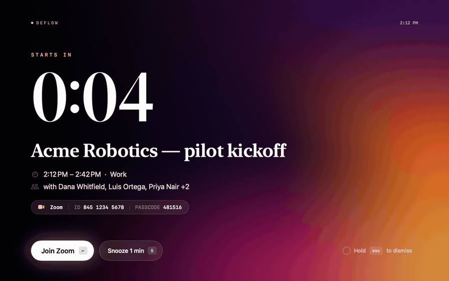
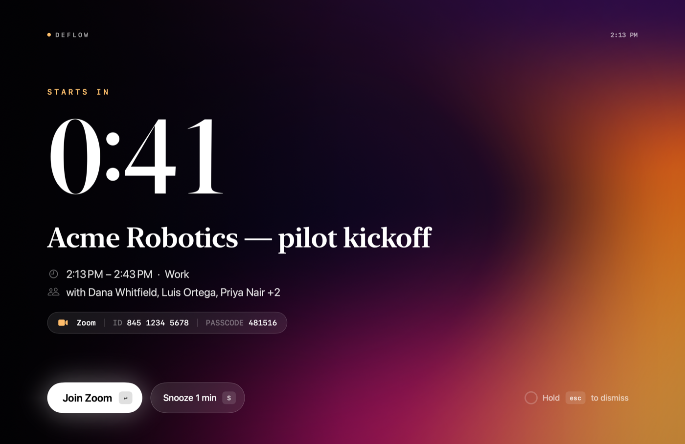
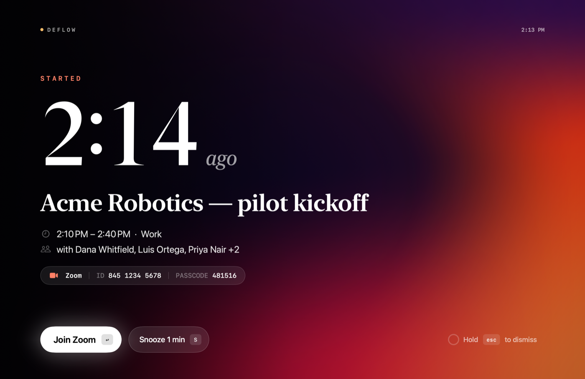
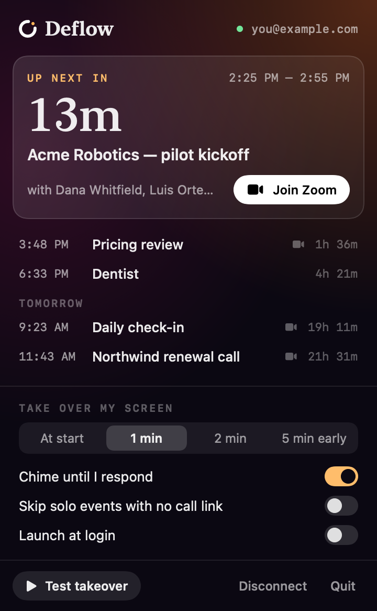

<p align="center"></p>

<h1 align="center">Deflow</h1>

<p align="center">
  <b>Never miss the meeting.</b><br>
  A macOS menu bar app that takes over your entire screen when a Google Calendar meeting starts.
</p>

<p align="center">
  <a href="https://github.com/ArchAstro/deflow/releases/latest/download/Deflow.dmg"></a>
</p>

<p align="center">
  <a href="https://github.com/ArchAstro/deflow/releases/latest"></a>
  <a href="https://github.com/ArchAstro/deflow/actions/workflows/ci.yml"></a>
  
  
  <a href="LICENSE"></a>
</p>

<p align="center"></p>

## Why

Notifications are easy to miss when you are deep in flow. A banner slides in, you glance past it, and
twenty minutes later a customer is sitting alone in a Zoom room.

Deflow cannot be glanced past. At meeting time it covers every display and stays there until you join,
snooze, or deliberately dismiss it.

## How it works

1. **It watches your Google Calendar**, read-only, for the next 24 hours.
2. **One minute before a meeting, it takes over.** Every display, above full-screen apps, with the Dock
   and app switcher disabled.
3. **Everything you need is on screen**: countdown, title, time, who is on the call, and the Zoom, Meet,
   Teams or Webex link with meeting ID and passcode.
4. **There are only three ways out.**

   | Key | What happens |
   | --- | --- |
   | <kbd>↩</kbd> | Joins the call. Zoom opens directly in the app, with no browser hop. |
   | <kbd>S</kbd> | Snoozes for one minute, then comes back. |
   | hold <kbd>esc</kbd> | Dismisses. A tap does nothing, so you cannot swat it away by reflex. |

5. **It gets louder when you are late.**

| Before the meeting | After it has started |
| --- | --- |
|  |  |
| Calm amber, counting down. | Red, counting up, chiming every 20 seconds. |

## The menu bar



Deflow lives in the menu bar, not the Dock.

- **Up next**: a countdown to your next meeting, with a one-click Join button.
- **Next 24 hours**: the rest of your agenda at a glance.
- **Lead time**: take over at the start, or 1, 2 or 5 minutes early.
- **Chime**: on or off.
- **Skip solo events**: ignore blocks that have no other people and no call link.
- **Launch at login**: so it is always watching.
- **Test takeover**: see exactly what a meeting will look like.

When a meeting is less than an hour away, the countdown also shows right in the menu bar.

<br clear="right">

## Install

1. **[Download Deflow.dmg](https://github.com/ArchAstro/deflow/releases/latest/download/Deflow.dmg)** and
   drag Deflow to Applications.
2. Open Deflow, click its menu bar icon, and choose **Sign in with Google**.
3. Approve read-only calendar access.
4. Click **Test takeover** to try it.

Requires macOS 15 or later. The app is signed with a Developer ID and notarized by Apple.

> [!NOTE]
> Google has not verified this app yet, so sign-in shows a "Google hasn't verified this app" screen.
> Choose **Advanced**, then **Go to Deflow**. The only permission requested is read-only calendar access.

## Privacy

- Deflow talks only to Google, directly from your Mac.
- There is no Deflow server, no account, no analytics.
- Access is read-only: Deflow cannot create, change or delete anything.
- The app ships no client secret; your sign-in token stays in your macOS Keychain.

Full details are in [PRIVACY.md](PRIVACY.md).

## Questions

<details>
<summary><b>Which events trigger a takeover?</b></summary>

Timed events on calendars you own and have ticked in Google Calendar. All-day events, cancelled events,
events you declined, out-of-office blocks and working-location entries are skipped. Calendars you only
subscribe to, such as a coworker's, never trigger one.
</details>

<details>
<summary><b>What if my Mac was asleep when the meeting started?</b></summary>

Deflow checks again on wake and still takes over for up to 10 minutes after the start time.
</details>

<details>
<summary><b>What if I get stuck behind the takeover?</b></summary>

Hold <kbd>esc</kbd> for a little over a second. The takeover also removes itself when the meeting ends.
</details>

<details>
<summary><b>Does it work with several monitors?</b></summary>

Yes. Every connected display is covered.
</details>

<details>
<summary><b>How do I remove it?</b></summary>

Choose **Disconnect** in the menu, quit, and delete the app. You can also revoke access at
<a href="https://myaccount.google.com/permissions">myaccount.google.com/permissions</a>.
</details>

## Build from source

Needs Xcode 16 or later.

```sh
./scripts/build-app.sh --run      # build build/Deflow.app and launch it
swift test                        # unit tests
./scripts/make-dmg.sh             # Developer ID signed DMG (set NOTARY_PROFILE to notarize)
```

```
Google Calendar API ──60s poll──▶ CalendarMonitor ──▶ TakeoverController ──▶ Join / Snooze / Dismiss
        ▲                                                                          │
   OAuth (PKCE, no client secret)                    ◀──────── snooze 60s ─────────┘
   refresh token in the macOS Keychain
```

| Path | What lives there |
| --- | --- |
| `Sources/DeflowCore` | Pure logic: Google Calendar parsing, meeting-link detection, trigger timing |
| `Sources/Deflow` | The app: OAuth, polling, takeover windows, menu panel, brand art |
| `Tests/DeflowCoreTests` | Unit tests for the core logic |
| `scripts` | App bundle and DMG builds |

The Google OAuth client ID in `GoogleAuth.swift` is a public identifier for an installed app. It has no
client secret; sign-in uses PKCE.

## License

[MIT](LICENSE)
